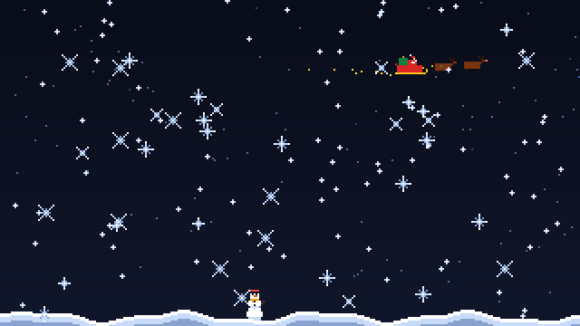
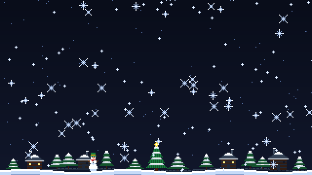
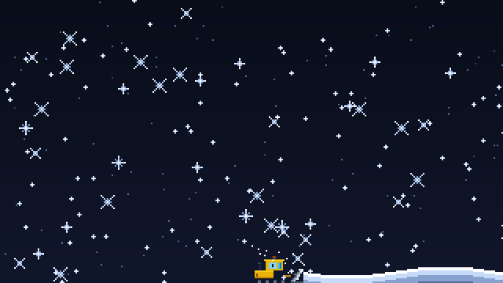

# Interactive-Wallpaper

> An interactive retro pixel-art winter wonderland pinned behind your desktop icons. Real-time snowfall physics, snowman builders, flying Santa, and holiday music — every flake rendered in pure pixel art.

---

## About

**Interactive-Wallpaper** transforms your desktop into a living, interactive retro pixel-art winter landscape. Pinned seamlessly behind your desktop icons without cluttering your taskbar, it combines physics-driven snowfall accumulation, multi-stage snowman building by cheerful pixel children, a flying Santa sleigh with a glowing Rudolph, embedded royalty-free YouTube holiday music, an optional cozy distant background village, and an animated yellow snowplow clearing machine — fully responsive and customizable in real time.

---

## Previews

| Interactive Snow Scene & Flying Santa |
| :---: |
|  |

| Background Winter Village & Holiday Star Tree | Yellow Snowplow Clearing Machine |
| :---: | :---: |
|  |  |

---

## Credits & Acknowledgements

Special thanks and credit go to:
- **[PixelFX](https://github.com/patch-gg/pixelfx)** by [`patch-gg`](https://github.com/patch-gg): An exceptional retro pixel-art VFX and particle rendering library. The particle simulation core, color mixing, and snowflake burst effects in this project are powered by PixelFX.

---

## Features

### 1. True Desktop Live Wallpaper Mode
- Pins directly behind your desktop icons using native Windows desktop window hierarchy (`WorkerW` / `Progman`).
- Automatically hides from the taskbar and stays running silently in your system notification tray.
- Seamless multi-resolution responsiveness (1920×1080 and higher).

### 2. Smart Taskbar Boundary Detection
- Actively detects taskbar placement and height (bottom, top, left, right, or auto-hidden).
- When the taskbar is visible at the bottom, the snow bank piles **directly on top of the taskbar**, ensuring the snow drift is never cut off or obscured.
- Automatically repositions if the taskbar auto-hides or moves.

### 3. Symmetric Snow Physics & Interactive Drifts
- Multi-layer snowfall:
  - **Layer 0**: Distant snow specks drifting in the background.
  - **Layer 1**: Mid-distance flakes drifting with wind.
  - **Layer 2**: Near-field rotating 6-arm ice crystals with spinning geometry.
- Natural symmetric avalanche slope-limiting relaxation prevents unnatural directional drift skew.
- **Interactive Snow Carving**: Click or drag your mouse across the snow bank to carve and fling snow spray!

### 4. Children Building Snowmen
- Once snow piles up, children in warm winter clothing arrive from the screen edges.
- They roll snowballs and construct a snowman in 3 stages (base snowball, torso snowball, head with carrot nose and top hat).
- The children admire their creation, smoothly turn around, and walk off-screen.
- **Interactive Snowman Destruction**: Left-clicking any completed snowman detonates it in a spectacular `ice/snowflake-burst` flurry!
- **Multi-Snowman Lifecycle**: After a snowman is built (or exploded), children return to build additional snowmen in open spots across the screen with randomized scales and colored top hats.

### 5. Flying Santa Sleigh
- Santa flies across the upper sky pulled by galloping reindeer, including **Rudolph** with a glowing additive red nose.
- Stardust trail sparkles stream directly from the rear tips of the golden sleigh runners.
- Configurable occurrence frequency (every 30s, 1m, 2m, or 3m) or immediate flight on demand.

### 6. Background Winter Village & Trees
- Distant snow-capped cottages with stone and timber walls, chimneys with gentle smoke wisps, and snow-draped pine trees.
- **Dynamic Window Lighting**: Random houses periodically turn their warm amber lights on and off for a living aesthetic.
- **Center Holiday Star Tree**: A lush 4-tier evergreen tree decorated with multi-colored fairy lights and a radiant golden star.
- **Submerging Snow Effect**: The village ground sits slightly above the snow baseline, so as the foreground drift accumulates, it realistically buries the village over time.
- **Toggleable**: Disabled by default in settings; enable whenever you want the cozy village aesthetic.

### 7. Yellow Snowplow Clearing Machine
- When resetting the snow bank, instead of a sudden disappearance, a yellow Caterpillar-style snowplow tractor drives across the screen.
- Features heavy black treads with rotating wheels, driver cabin, headlights, and a **flashing amber hazard beacon** with an ambient warning glow.
- The curved steel blade scrapes the snowbank flat, sending snow plumes into the air while **keeping all snowmen and children in place**.
- Revealing the buried winter village once again!

### 8. Royalty-Free Christmas Music
- Embedded non-copyrighted Christmas music playlist from YouTube.
- Starts paused initially; user controls playback (Play/Pause, Next Track, Previous Track, Volume) from both the HUD and the System Tray.

---

## Installation & Getting Started

### Prerequisites
- **Windows 10 / 11** (for desktop live wallpaper mode; also supports macOS and Linux in windowed preview mode).
- **Node.js** (v18 or higher recommended): [Download Node.js](https://nodejs.org/)
- **Git**: [Download Git](https://git-scm.com/)

### Step-by-Step Setup

1. **Clone the Repository**:
   ```bash
   git clone https://github.com/thalthanas/Interactive-Wallpaper.git
   cd Interactive-Wallpaper
   ```

2. **Install Dependencies**:
   ```bash
   npm install
   ```

3. **Start the Application**:
   ```bash
   npm start
   ```

4. **Background Operation**:
   - The wallpaper attaches immediately behind your desktop icons.
   - An icon appears in your Windows **System Tray** (notification area).
   - **Controls & HUD Access**:
     - In **Windowed Mode**, press <kbd>H</kbd> on your keyboard to open or close the on-screen Control HUD.
     - In **Desktop Wallpaper Mode**, the window is pinned behind your desktop icons and does not hold keyboard focus, so all settings, sliders, and toggles are accessed by **right-clicking the System Tray icon** (you can also switch to Windowed Mode via the tray at any time to use the <kbd>H</kbd> HUD).

---

## Scene Settings & Controls

All settings can be customized by **right-clicking the System Tray icon** (in any mode) or from the **on-screen HUD** (<kbd>H</kbd> in Windowed Mode):

| Setting | Options / Range | Description |
| :--- | :--- | :--- |
| **Pixel Art Scale** | 8x, 6x, 4x, 2x, 1x | Adjusts resolution chunky retro (6x = 320×180) to crisp high-density. |
| **Snowfall Density** | Light (0.5x) to Blizzard (2.8x) | Number of snowflakes active simultaneously. |
| **Snowflake Scale** | 1x (Native 1080p), 2x, 3x, 4x, 6x (Retro - Default), 8x | Independently scales snowflake resolution canvas while keeping scene/sprite pixel scale. |
| **Drift Piling Speed** | Off (0x), Slow (0.5x), Normal (1.0x), Fast (2.0x), Blizzard (3.5x) | Rate of snow bank accumulation at the bottom. |
| **Max Pile Height** | 15%, 25%, 35%, 50% Screen | Maximum height the snow mound is allowed to reach. |
| **Wind Speed** | Calm (0), Gentle (4), Brisk (8), Gale (14) | Horizontal drift force applied to snowflakes. |
| **Flying Santa Sleigh** | Checkbox & Interval (30s – 3m) | Toggles Santa's flights and frequency; includes immediate flight button. |
| **Background Village & Trees** | Checkbox (Default: Off) | Enables the cozy background cottages, blinking window lights, and holiday star tree. |
| **Clear Drift (Snowplow)** | Button / Tray Action | Launches the yellow snowplow tractor to clear the accumulated snowbank. |
| **Build Another Snowman** | Button / Tray Action | Immediately sends children to build a snowman in an open spot. |
| **Christmas Music** | Play, Pause, Next, Prev, Volume Slider | Controls the background YouTube holiday playlist. |
| **Desktop / Windowed Mode** | Radio Option | Switch between true desktop live wallpaper and windowed preview mode. |
| **Pause Animation** | Button / Tray Action | Freezes animation and disables mouse clicks/trails while paused. |

---

## Controls Summary

- **Toggle HUD Settings**: Press <kbd>H</kbd> (in Windowed Mode)
- **Context Menu & Controls**: Right-click the System Tray icon (available anytime in both Desktop & Windowed modes)
- **Destroy Snowman**: Left-click on any completed snowman
- **Carve Snow**: Click or drag mouse through the bottom snow mound
- **Mouse Sparkles**: Left-click anywhere on the desktop
- **Quit**: Right-click the System Tray icon -> **Quit Interactive Wallpaper**

---

## License

This project is open-source under the MIT License. External libraries and components belong to their respective creators:
- `pixelfx` graphics and particle engine &copy; [patch-gg/pixelfx](https://github.com/patch-gg/pixelfx) (MIT License).
